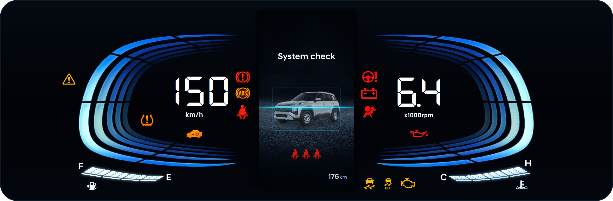
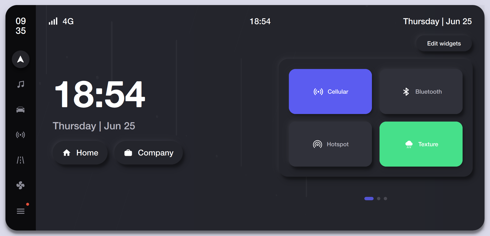
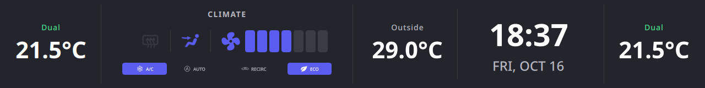

# Infiniti G35 Multi-Display Infotainment System

Triple-display automotive HMI in C++20 and Qt 6 (QML), driven by a shared CAN telemetry layer. Target: Radxa ROCK 5B+ (RK3588, Linux/Wayland, SocketCAN). Dev host: macOS or Linux with mock CAN fallback.

## Screens

### Cluster (1920x720)



Digital instrument cluster: speed and RPM gauges, coolant and fuel bars, gear indicator, telltales, trip computer, TPMS, and themes. Details: [cluster/README.md](cluster/README.md). Run: `just run-cluster`.

### Head Unit (1920x1080)



Smart UI home screen: clock, quick controls, weather, music, vehicle controls, energy, and settings with light and dark themes. Details: [dashboard/README.md](dashboard/README.md). Run: `just run-dash`.

### Climate Ribbon (1920x480)



Dual-zone climate strip: driver and passenger setpoints, HVAC status with direction and fan icons, A/C, AUTO, RECIRC, and ECO chips, outside temp, and clock. Details: [climate/README.md](climate/README.md). Run: `just run-clima`.

### Emulator

Standalone ECU test bench driving all screens over CAN. Run: `just run-emu`, or everything at once with `just run-all`.

## CAN layer

`core/` holds the shared `VehicleState`, Nissan CAN codec (`0x1F9`, `0x280`, `0x54C`, ...), `SocketCanBackend` for `vcan0`/`can0`, and `MockCanBackend` multicast fallback when no CAN interface exists. Every app tries SocketCAN first and falls back automatically, so the emulator drives every screen with zero setup.

## Build

```bash
cmake -S . -B build -DCMAKE_BUILD_TYPE=Debug
cmake --build build -j$(nproc)
./build/core/core_test
```

## Credits

- Cluster UI builds on the open-source [APEX Horizon AMT cluster](https://github.com/skrehanahamed/Apex_MidEnd_Cluster) community project.
- Head unit UI builds on the open-source [professional vehicle dashboard](https://github.com/cppqtdev/professional-vehicle-dashboard) community project.
